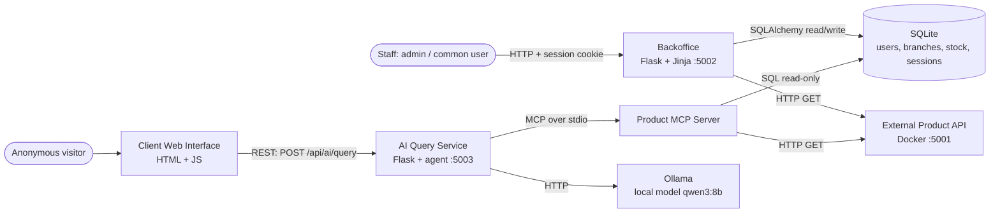
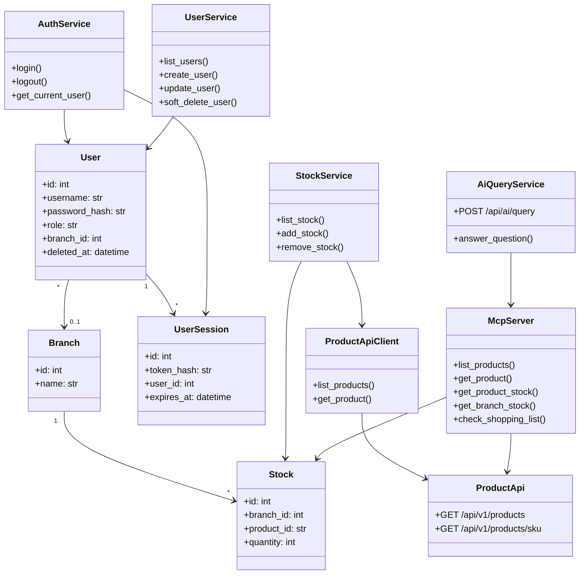

# HBntory - Architecture

## 1. Which services your system will include ?

- Backoffice → Flask app for employees queries
- AI Service → Receive user’s question, ask to AI Model and returns the answer
- AI Model → Understand questions, execute MCP Tools and return answers
- MCP Server → Receive AI service calls and request data from the Product API and Database
- Product API → Read-Only data source on docker
- Database → SQLite relational database with users, branches and stock quantities (no product details)

## 2. The responsibility of each service ?

- Backoffice → Login, Stock management, User management
- AI Service → Handle the user’s question and retrieve answers using Server MCP
- MCP Server → Expose tools for the AI service to read product data and stock data
- Database → Store users, branches, stock quantities and login sessions
- Product API → Provide product data (Read-Only)
- AI Model → Local LLM (`qwen3:8b` with Ollama) used to understand natural language and write answers

## 3. How the services communicate with each other ?

- Client Web → AI Service: REST Request (HTTP `POST /api/ai/query`)
- AI Service → AI Model: HTTP Request to Ollama (`/api/chat`)
- AI Service → MCP Server: Tool Calls (MCP over stdio)
- MCP Server → Product API: HTTP Request
- MCP Server → Database: SQL (Read-Only)
- Backoffice → Database: SQL via SQLAlchemy (Read + Write)
- Backoffice → Product API: HTTP Request

## 4. Which data is stored locally ?

- Users (username, password hash, role, branch, deleted status)
- Branches
- Stock (branch, product_id, quantity)
- Login sessions (hashed token, user, expiration date)
- Only the product_id is stored for products, never the product details

## 5. Which data comes from the external Product API ?

- Products informations (ID, sku, name, description, category, brand, supplier_id, supplier_name, unit_price, currency, discontinued, weight_kg, tags)

- The SKU (`sku`) is the identifier we store locally as `product_id`, it is the only link between our database and the Product API

## 6. How the AI agent will access product and stock information ?

- The agent has no direct access to the database or to the Product API, it only uses the MCP tools
- Product information: `list_products` and `get_product`, which call the Product API
- Stock information (read-only):
  - `get_product_stock` → the stock of one product in every branch
  - `get_branch_stock` → all the products in stock in one branch
  - `check_shopping_list` → checks if a list of products can be bought, and in which branches
- The MCP Server reads the database with read-only SQL, and the AI Service starts it as a subprocess (stdio)
- Answers must only use the tool results: if the information is not available, the answer says so

##  Service diagram

## User diagram

