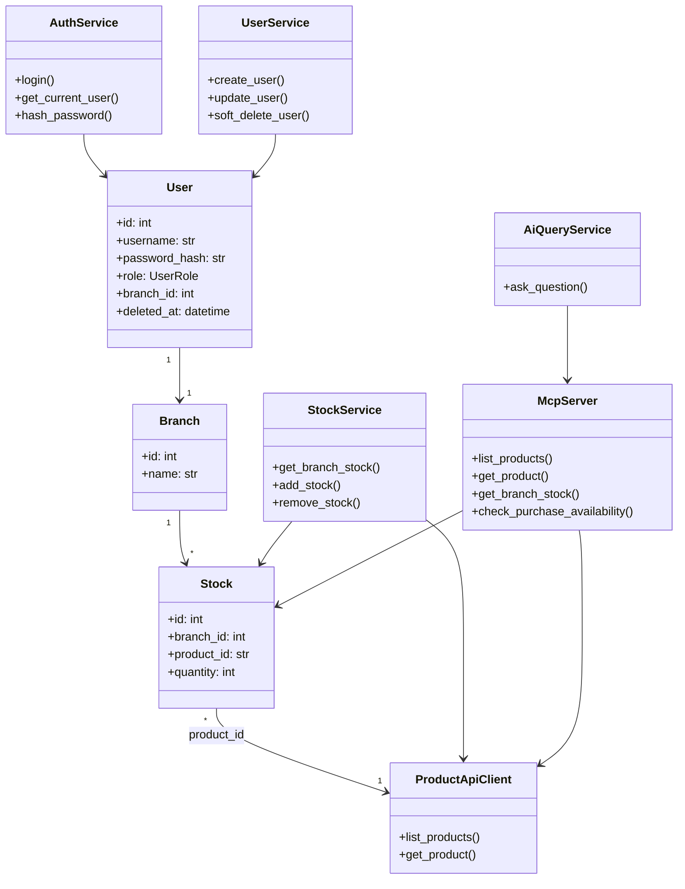

# HBntory - Architecture

## 1. Which services your system will include ?

- Backoffice → Flask app for employees queries
- AI Service → Receive user’s question, ask to AI Model and returns the answer
- AI Model → Understand questions, execute MCP Tools and return answers
- MCP Server → Receive AI service calls and request data from the Product API and Database
- Product API → Read-Only data source on docker
- Database → SQLite relational database with products informations and user informations.

## 2. The responsibility of each service ?

- Backoffice → Login, Stock management, User management
- AI Service → Handle the user’s question and retrieve answers using Server MCP
- MCP Server → Expose tools for the AI service to read product data and stock data
- Database → Store users, branches, and stock quantities
- Product API → Provide product data (Read-Only)
- AI Model → Local LLM used to understand natural language and write answers

## 3. How the services communicate with each other ?

- Client Web → AI Service: REST Request
	- AI Service  → Server MCP: Tool Calls
	- Server MCP →  Product API: HTTP Request
	- Server MCP → Data Base: Read-Only
	- Backoffice →  Data Base: Read + Write
	- Backoffice → Product API: HTTP Request

## 4. Which data is stored locally ?

- Users data (Username, password hashed, role, branch)
- Stock (ID, Quantity, Branch)

## 5. Which data comes from the external Product API ?

- Products informations (ID, sku, name, description, category, brand, supplier_id, supplier_name, unit_price, currency, discontinued, weight_kg, tags) 

## 6. How the AI agent will access product and stock information ?

##  Service diagram 

## User diagram

