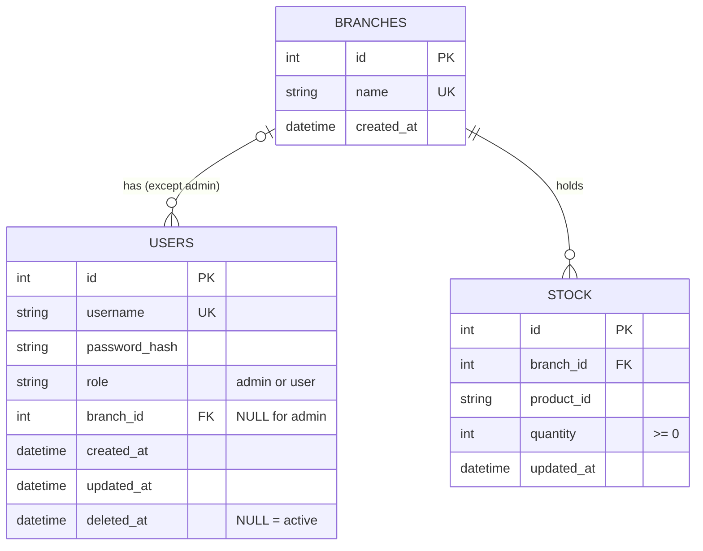

## Database Schema

- Branches - id, name

- users - id, username, password hashed, role, isDeleted, branch_id

- Stock - id, branch, product_id, quantity

## Database Relations
- branches (1) ────< users (0..)
- branches (1) ────< stocks (0..)
- stocks (*) ────> external_product_id (Product API Reference)

