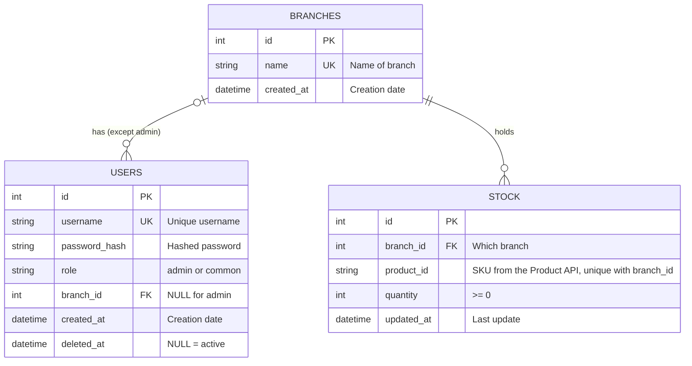

# Database

## Database Schema

- **branches**: id, name, created_at
- **users**: id, username, password_hash, role, branch_id, created_at, deleted_at
- **stock**: id, branch_id, product_id, quantity, updated_at

## Database Relations

- branches (1) ────< users (0..*)
- branches (1) ────< stock (0..*)
- stock (*) ────> product_id (reference to the Product API, no local foreign key)

## Database Rules

- A common user belongs to exactly one branch.
- The admin user has no branch and no stock-management responsibilities.
- Users are soft-deleted by setting a value in the `deleted_at` column instead of removing the row. A deleted user can't log in anymore, and the stock of their branch is never deleted.
- A branch can have multiple stock lines.
- Stock is identified by a branch and an external product identifier. The pair (`branch_id`, `product_id`) is unique.
- `product_id` is the **SKU** of the product in the Product API.
- Stock quantity is always >= 0.
- Product details (name, description, price, images, metadata) are not stored here, only in the Product API.

## Field Justification

- `created_at`: records when a branch or a user was created.
- `updated_at` (stock only): records when a quantity last changed. Stock changes often, users rarely, so only stock has it.
- `deleted_at`: implements the soft delete (`NULL` = active user).
- `role`: distinguishes the admin from common users (`admin` or `common`).
- `password_hash`: stores the hashed password, never the plain text.
- `product_id`: the SKU of the product in the Product API, the only link between our database and the product data.

## Stock Validation Rules

Validation is placed in **two layers**.

**1. Business layer (`backoffice/stock_service.py`).** Every stock change goes through `add_stock` and `remove_stock`, which check, in this order:

1. the quantity is a whole number strictly greater than zero;
2. the branch exists;
3. the product exists in the Product API (when adding stock);
4. there is enough stock (when removing stock).

If a rule fails, nothing is modified and a clear error message is returned.

*Why here:* it gives readable error messages, it can call the external Product API (the database can't), and it is a single place used by every caller.

**2. Database layer (constraints in `models.py`).**

- `CHECK (quantity >= 0)`: stock can never be negative.
- `UNIQUE (branch_id, product_id)`: one stock line per branch and product.
- Foreign keys: stock and users must reference an existing branch.
- `CHECK` on users: an admin has no branch, a common user has one.

*Why here:* it is the last safety net. Even if the code has a bug, the database refuses invalid data.

**Known limitation:** the quantity is read and then updated in two steps, so two simultaneous requests could overlap. The `quantity >= 0` constraint still prevents a negative stock.

## Database Initialization

The script `backoffice/init_db.py` (run from the `backoffice/` folder) creates the tables, two branches, the admin user and sample stock.

- The admin password is read from the `HBNTORY_ADMIN_PASSWORD` environment variable and stored as a bcrypt hash. It is never written in the code.
- Sample stock uses the real SKUs of the Product API, so the Product API must be running. If it is not, the sample stock is skipped and the script can be run again later.
- The script can be run several times without creating duplicates.

## Diagram

