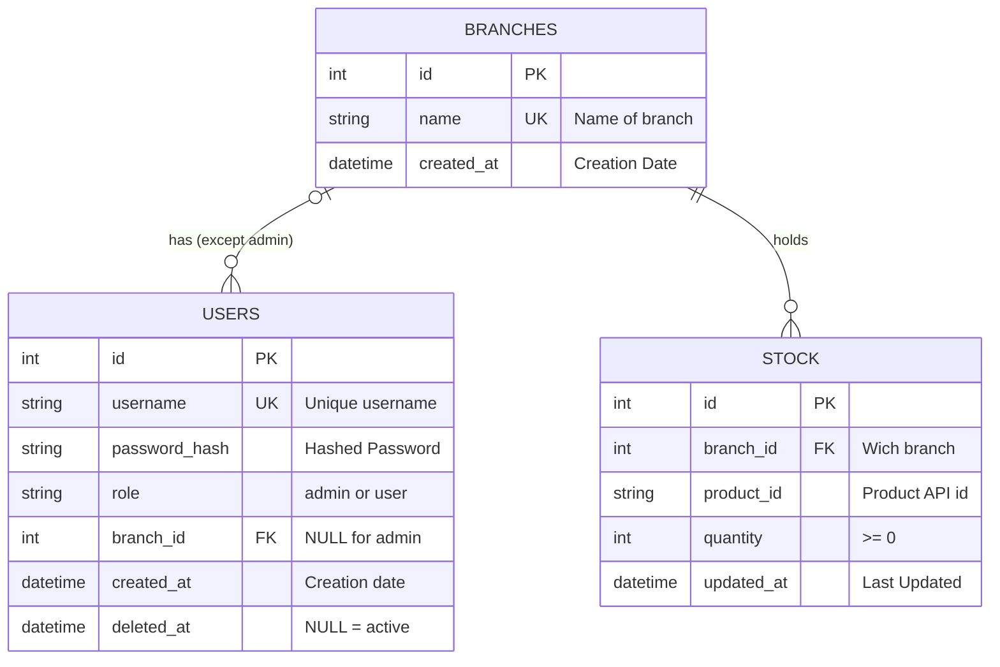

## Database Schema

- Branches - id, name, created_at

- users - id, username, password_hash, role, branch_id, created_at, updated_at, deleted_at

- Stock - id, branch_id, product_id, quantity, updated_at

## Database Relations

- branches (1) ────< users (0..)

- branches (1) ────< stocks (0..)

- stocks (*) ────> external_product_id (Product API Reference)

## Database Rules

- An user has one branch.
- An Admin user has no branch.
- The deleted_at is a soft delete; wich keep informations of branch created by a deleted user.
- A branch can have multiple stocks.
- Each stock is >= 0.
- Products details aren't stocked here, only on the Product API.

